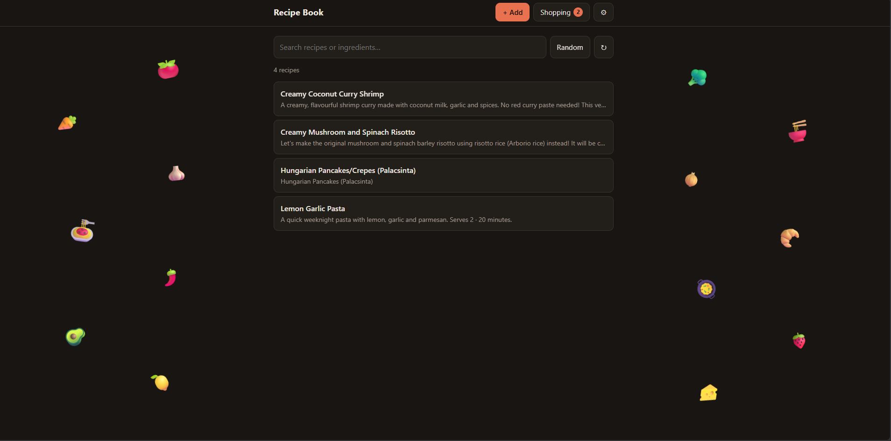

# Recipe Book

## Why I Built This Project

I built this project to solve a small but recurring problem in my everyday life: figuring out what to cook using the ingredients I already have at home.

I often use Large Language Models (ChatGPT or Claude) to generate recipe ideas based on the ingredients available in my kitchen. One of the things I enjoy most about these tools is their ability to suggest creative ingredient combinations, interesting spice pairings, and simple techniques that can improve the flavor of a dish. They often come up with recipes that are easy to prepare, surprisingly delicious, and worth making again.

However, once I find a recipe I like, I need a convenient way to save it for future use instead of searching through old conversations to find it again. This inspired me to build a simple, personal recipe book where I can collect and organize recipes in one place.

This self hostable website allows users to copy and paste recipe suggestions directly from tools such as ChatGPT or Claude and save them as recipes. This makes it easy to build a personal cookbook filled with recipes tailored to individual tastes, available ingredients, and cooking preferences.

Another important feature is the shopping list function. Users can select recipes they plan to cook and collect their ingredients into a shopping list. They can then copy the list and use it when shopping for groceries, making meal planning more convenient and reducing the effort required to prepare for multiple meals.

I intentionally kept the project simple by building it with HTML, CSS, and Markdown. The idea was to create a lightweight, accessible, and easy-to-use website without unnecessary complexity. 

## Files

| File | What it is |
|---|---|
| `index.html` | The whole website |
| `recipes/*.md` | Your recipes, one file each (`lemon-garlic-pasta.md` is an example you can delete later) |
| `.nojekyll` | Tells GitHub Pages to serve the files as they are, without processing them |

## Setup (about 10 minutes, once)

1. **Create a repository** on GitHub, for example `My-recipe-book`. It must be **public**, because free
   GitHub Pages only works with public repos.
2. **Upload these files** to the repo: on the repo page, click **Add file → Upload files** and drag in
   `index.html`, `.nojekyll` and the `recipes` folder, then click **Commit changes**.
3. **Turn on Pages**: go to **Settings → Pages**, set *Source* to **Deploy from a branch**, choose
   **main** and **/ (root)**, then click **Save**. After a minute your site is at
   `https://<your-username>.github.io/My-recipe-book/`.
4. **Optional, for one-click saving: create a token.**
   - Go to <https://github.com/settings/personal-access-tokens/new>.
   - Give it a name and an expiration. You'll need a new one when it expires.
   - Under **Repository access**, choose **Only select repositories** and pick your recipe repo.
   - Under **Permissions → Repository permissions**, set **Contents** to **Read and write**.
   - Click **Generate token**, copy it, and paste it into the site's **Settings** page. Do this once on each
     device you use (phone, laptop).

   The token stays in your browser. It is never put in the code, so nobody else can add recipes.

The username and repo name are detected from the address when the site runs on GitHub Pages. You only need
to replace `YOUR-GITHUB-USERNAME` and `YOUR-REPO-NAME` in `index.html` if you open the file directly on
your computer, or if you use a custom domain.

## Using it

- **Add a recipe**: copy the recipe from the LLM, tap **+ Add**, paste it, check the title and tap **Save**.
  - With a token, it's saved right away.
  - Without a token, GitHub opens with the recipe filled in. Click **Commit changes** there.
- **Find a recipe**: search by name or ingredient (for example `chicken rice`).
- **Can't decide?** Tap **Random** to pick from the current list. Search first to narrow it down
  (for example, search `vegetarian`, then tap **Random**).
- **Shopping list**: open a recipe and tap **Add to shopping list**. The **Shopping** page shows each
  recipe's name with its ingredients. Tick items off as you shop, remove single recipes, tap
  **Copy list** to copy everything as text (for your notes app or a chat), or tap **Clear list** to empty it.
  Switch to **Combined** to see one list where the same ingredient from different recipes is added up
  (for example, 200 g + 300 g spaghetti becomes 500 g spaghetti). Below each item it shows which recipes need it. The list is saved only in the browser you use. It does not sync between
  your phone and laptop, so build it on the device you'll take shopping.
- **Edit or delete**: open the recipe and tap **Edit or delete on GitHub**.
- A recipe added or edited directly on GitHub can take a few minutes to show up. Tap **↻** to reload.

## Tip: getting a consistent format from the LLM

Add this to your message to the LLM (the Add page has a copy button for it):

> Please give me the full recipe in Markdown. Start with a single '# ' heading with the name of the dish,
> then a one-line description, servings and total time. Then a '## Ingredients' section as a bullet list
> and a '## Steps' section as a numbered list.
